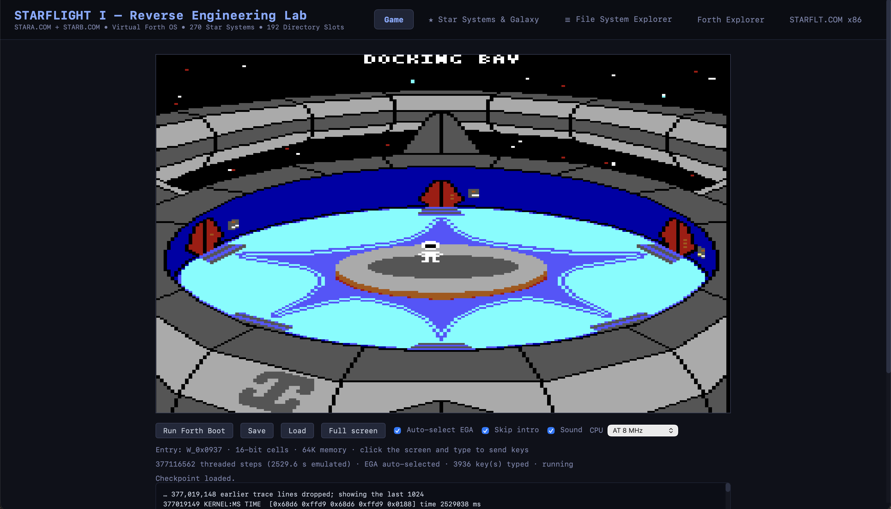

# Starflight I

Reverse Engineering project for one of the greatest games ever: Starflight.

Initially, I was just playing around with the DOS version,
but somehow, it turned into a fully playable version right in the browser.

Note: Please only use this with a licensed copy of Starflight. You can legally buy it for a few bucks from e.g. [GOG](https://www.gog.com/en/game/starflight_1_2).

Usage: After providing the original binaries (STARFLT.COM, STARA.COM, STARB.COM), click on "Run Forth Boot" to execute Starflight's Forth code right in the browser.

Try it here: [https://haraldf.github.io/starflight-js/](https://haraldf.github.io/starflight-js/).

Use the Save/Load buttons to save or load your game. As the original game, only one save is supported.

## Caveats

* Only EGA is supported
* The game and save file is cached in IndexedDB right in your browser
* The in-game save is not supported. Please use the "save" button on the web page
* Some inline functions might still be missing. If you get a crash/hang, please provide the error message under the game and the last few lines of the trace in a bug report.

## Geeky stuff

* Starflight internally is organized like a file system, you can use the file system explorer to snoop around.
* Starflight is written in Forth with a few x86 assembly functions. Use The "Forth Explorer" to read the Forth code and use the disassembler to look at the x86 code.
* This port includes a small Forth engine capable enough to run the Starflight Forth code. The x86 assembly functions are reimplemented in TypeScript.
* EGA and Sound are emulated through HTML Canvas / Audio.

## Thanks

* Thanks to the original authors of the game for the countless hours of exploration and fun (and frustration when my ship got blasted into space).
* Thanks to the authors of https://github.com/s-macke/starflight-reverse - it saved me a lot of time for reverse engineering.
